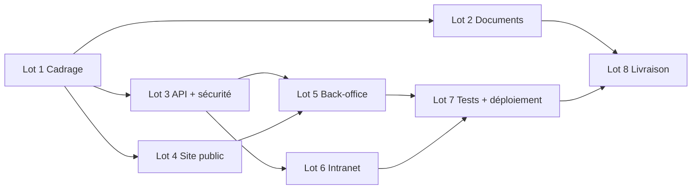

# WBS — Work Breakdown Structure

> Référence : cahier des charges, section 8. **7 lots + 1 livraison** ; tout est rendu le **11 décembre 2026**.
> Statuts : 🟦 à faire · 🟨 en cours · 🟩 terminé · ⛔ bloqué (question client ouverte).

## Vue d'ensemble

| Lot | Nom                      | Besoins couverts | Échéance proposée | Statut |
| --- | ------------------------ | ---------------- | ----------------- | ------ |
| 1   | Cadrage et maquettes     | Toutes           | 27 nov. 2026      | 🟨     |
| 2   | Documents projet         | Toutes           | 4 déc. 2026       | 🟨     |
| 3   | API, comptes et sécurité | F8–F11, N1–N3    | 8 déc. 2026       | 🟦     |
| 4   | Site public              | F1–F7            | 8 déc. 2026       | 🟦     |
| 5   | Back-office et pages     | F15–F19          | 10 déc. 2026      | 🟦     |
| 6   | Intranet de documents    | F12–F14          | 10 déc. 2026      | 🟦     |
| 7   | Tests et déploiement     | N5–N10           | 11 déc. 2026      | 🟦     |
| 8   | Livraison / soutenance   | Tous             | 11 déc. 2026      | 🟦     |

## Lot 1 — Cadrage et maquettes

- Questions au client et hypothèses (voir `06-hypotheses-et-questions.md`).
- Validation de la stack (ADR `0001`).
- Faisabilité et estimation.
- Maquettes bleu ciel **responsives** (desktop / tablette / mobile).
- **Livrables** : compte-rendu de cadrage, maquettes, hypothèses validées par écrit.

## Lot 2 — Documents projet

- Cahier des charges (ce dépôt : `Docs/01-cahier-des-charges.md`).
- WBS (ce fichier).
- Plan de tests (`Docs/03-plan-de-tests.md`).
- Architecture (`Docs/04-architecture.md`) et charte (`Docs/05-charte-graphique.md`).
- **Livrables** : documents versionnés dans `Docs/`, relus par la MOA.

## Lot 3 — API, comptes et sécurité

- API Spring Boot 4 / Java 21, PostgreSQL (H2 en dev), Spring Data JPA.
- Authentification identifiant ou email + mot de passe, réinitialisation (F8).
- Quatre rôles et contrôle d'accès serveur (F9, N1).
- Blocage après échecs répétés + déblocage admin (F10, N2).
- Création de comptes et inscriptions par un admin (F11).
- Paramètre `candidature.url` exposé au front (F6, H5).
- **Livrables** : API conteneurisée, migrations, tests de sécurité par rôle.

## Lot 4 — Site public

- Accueil : recrutement, rentrées, chiffres clés, financement, partenaires, labels (F1).
- Catalogue avec recherche + filtre par niveau (F2).
- Fiche formation complète + plaquette PDF (F3).
- Approche pédagogique et équipe (F4).
- Contact avec consentement RGPD + honeypot anti-spam (F5).
- Bouton « Candidater » configurable (F6) et lien réunion (F7).
- **Livrables** : pages React accessibles et responsive (contenu de référence à demander à la cliente).

## Lot 5 — Back-office et pages

- Tableau de bord admin (F15).
- Édition sans code des pages et contenus via modèles simples (F16).
- Médias (F17), messages de contact (F18), historique (F19).
- **Livrables** : écrans protégés, CRUD pages, journalisation.

## Lot 6 — Intranet de documents

- Dossiers imbriqués et dépôt PDF par l'enseignant/admin (F12).
- Lecture/téléchargement par étudiant inscrit uniquement (F13).
- URLs de téléchargement protégées par l'API (F14, N3).
- **Livrables** : arborescence, upload, contrôle d'accès serveur testé.

## Lot 7 — Tests et déploiement

- Tests par rôle (visiteur/étudiant/enseignant/admin/super admin).
- Accessibilité RGAA AA (N8), responsive (N5), performance < 2 s (N7).
- Docker Compose, documentation d'installation (N9, N10), démo.
- **Livrables** : plan de tests exécuté, `docker compose up`, README à jour.

## Lot 8 — Livraison

- Dépôt GitHub public `claraops/CEFISI` propre (README, licence d'usage, docs, CI verte).
- Démonstration le 11 décembre ; soutenance reportée si besoin.

## Dépendances

## Rythme et rules de groupe

- Point court quotidien (15 min) : fait / à faire / bloquants.
- Chaque tâche = une **issue GitHub** avec label `lot-1` … `lot-7`, puis une **branche** dédiée par périmètre (`docs`, `front`, `backend`, `database`, `docker`).
- Pour l'instant, pas de PR : chacun pousse sur sa branche avec des commits commentés, on teste, puis on valide. Les PR vers `dev` puis `main` arriveront plus tard.
- `main` reste la branche principale et stable ; `dev` sert à l'intégration et aux tests communs.
- Les besoins **M** priment sur les **S** : si le délai serre, F7, F17, F18, F19 sont les premiers remis à plus tard.
