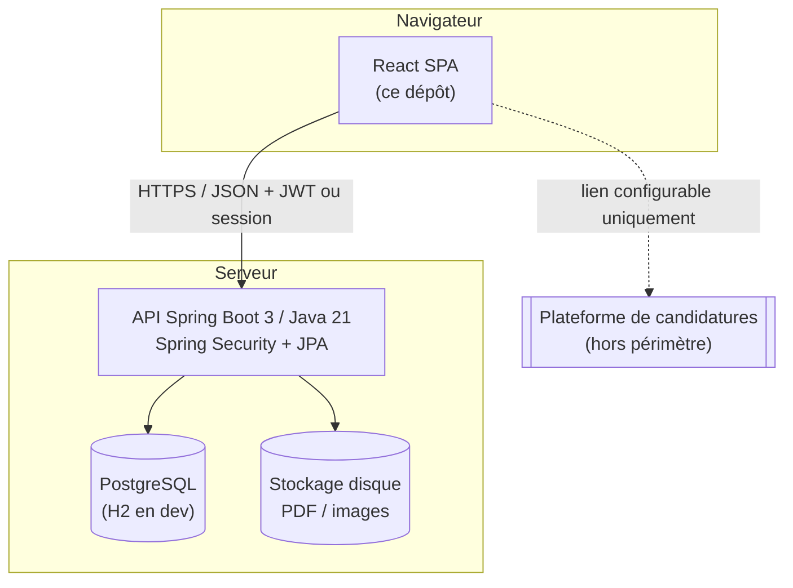
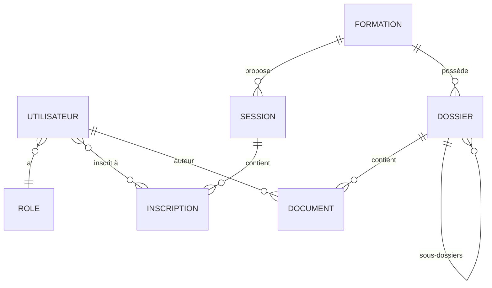

# Architecture technique

> Proposition de l'équipe (à valider par la cliente). Source : cahier des charges, sections 7 et 6.

## 1. Principe directeur

Le navigateur ne parle **jamais** à la base de données ni aux fichiers. Il parle à une **API Spring Boot** qui est le seul point d'accès, vérifie les droits à chaque requête et sert les PDF via des URLs protégées.



## 2. Couches du front (structure cible — à créer)

```
Front/src/
├── app/          # composition : routeur, layouts, providers
├── components/   # composants partagés (layout + ui)
├── features/     # découpages métier (formations, contact, auth, intranet, admin)
├── pages/        # pages routées, fines, qui assemblent les features
├── data/         # données de démonstration (remplacées par l'API)
├── lib/          # client API, utilitaires
├── config/       # variables d'environnement typées
├── types/        # modèle de données TypeScript (12 entités)
└── styles/       # Tailwind + thème daisyUI « cefisi »
```

Règles :

- Une page ne contient **pas** de logique métier lourde : elle assemble des composants de `features/`.
- Les appels API passent par `Front/src/lib/api.ts` : aucun `fetch` éparpillé dans les composants.
- Les données affichées aujourd'hui viennent de `Front/src/data/` ; elles seront remplacées par les endpoints sans changer les composants (contrats typés dans `Front/src/types/domain.ts`).
- Variables d'environnement lues uniquement via `Front/src/config/env.ts` (avec valeurs par défaut sûres).

## 3. Modèle de données côté front

Les 12 entités du cahier des charges sont typées dans `Front/src/types/domain.ts` : `Utilisateur`, `Role`, `Formation`, `Session`, `Inscription`, `Dossier`, `Document`, `Page`, `MessageContact`, `MembreEquipe`, `Parametre`, `JournalConnexion`.



## 4. Règles de sécurité à respecter

| Règle                     | Responsable | Détail                                                                                         |
| ------------------------- | ----------- | ---------------------------------------------------------------------------------------------- |
| Rôle vérifié côté serveur | API         | Le front peut masquer un bouton, **jamais** servir de justification de sécurité.               |
| Documents protégés        | API         | `GET /api/documents/{id}/download` vérifie rôle + inscription ; pas de fichier dans `public/`. |
| Consentement RGPD         | Front + API | Case à cocher obligatoire, horodatage stocké avec le message.                                  |
| Anti-spam                 | Front + API | Champ honeypot masqué + validation serveur.                                                    |
| Anti force brute          | API         | Compteur par utilisateur/IP, blocage temporaire, déblocage admin.                              |
| Mots de passe             | API         | Hachage (bcrypt/Argon2), jamais stockés en clair, jamais loggés.                               |
| XSS/CSRF/injection        | Les deux    | Échappement React, requêtes préparées, jeton CSRF si session, en-têtes de sécurité.            |
| HTTPS                     | Déploiement | Redirection HTTP → HTTPS, HSTS.                                                                |

## 5. Contrat API proposé (à confirmer avec le lot 3)

| Méthode | Route                             | Rôle minimal                          | Usage front                      |
| ------- | --------------------------------- | ------------------------------------- | -------------------------------- |
| `POST`  | `/api/auth/login`                 | public                                | F8                               |
| `POST`  | `/api/auth/logout`                | authentifié                           | F8                               |
| `POST`  | `/api/auth/forgot-password`       | public                                | F8                               |
| `GET`   | `/api/me`                         | authentifié                           | Profil (F8)                      |
| `GET`   | `/api/formations`                 | public                                | F2 (recherche + filtre en query) |
| `GET`   | `/api/formations/{slug}`          | public                                | F3                               |
| `GET`   | `/api/equipe`                     | public                                | F4                               |
| `POST`  | `/api/contact`                    | public                                | F5                               |
| `GET`   | `/api/parametres/candidature-url` | public                                | F6                               |
| `GET`   | `/api/sessions/next`              | public                                | F1                               |
| `GET`   | `/api/dossiers?formationId=`      | étudiant / enseignant / admin         | F12–F14                          |
| `POST`  | `/api/documents`                  | enseignant / admin                    | F12                              |
| `GET`   | `/api/documents/{id}/download`    | étudiant inscrit / enseignant / admin | F13, F14                         |
| `GET`   | `/api/admin/pages`                | admin                                 | F16                              |
| `PUT`   | `/api/admin/pages/{id}`           | admin                                 | F16                              |
| `GET`   | `/api/admin/messages`             | admin                                 | F18                              |
| `GET`   | `/api/admin/audit`                | admin                                 | F19                              |
| `PUT`   | `/api/admin/parametres/{key}`     | super admin                           | F6, H5                           |

## 6. Configuration (variables d'environnement)

| Variable               | Défaut                         | Rôle                                                            |
| ---------------------- | ------------------------------ | --------------------------------------------------------------- |
| `VITE_API_BASE_URL`    | `/api`                         | Base de l'API (proxy Vite en dev).                              |
| `VITE_CANDIDATURE_URL` | URL de la plateforme existante | Repli si le paramètre back-office n'est pas encore chargé (F6). |
| `VITE_SITE_NAME`       | `CEFISI`                       | Nom affiché dans l'interface.                                   |

> `VITE_*` est exposé au navigateur : **aucun secret** ne doit y être placé. Les secrets restent côté API.

## 7. Déploiement

- **Dev** : `npm run dev` (Vite, proxy `/api` vers Spring Boot) + H2.
- **Demo** : `docker compose up` (API + base + fichiers + front statique servi par un reverse proxy).
- **CI** : GitHub Actions → `cd Front && npm ci`, typecheck, lint, build à chaque push.
- `main` = branche principale et stable ; `dev` = branche d'intégration de groupe. Pas de PR pour l'instant : on pousse sur sa branche, on teste, puis on valide.

## 8. Décisions

Voir [`adr/0001-frontend-stack.md`](./adr/0001-frontend-stack.md) pour le choix React/TypeScript/Vite/Tailwind/DaisyUI.
